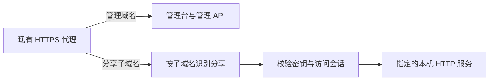

# Porthole 端口分享

Porthole 成员从本机监听的 50100–50999 端口中选择 HTTP 或 HTTPS 服务，为同一个服务创建一条或多条独立分享。「已发现端口」支持按完整或部分端口号即时筛选。创建分享时可在「监听端口」下拉中搜索端口，服务名称默认使用所选端口号，并可手动修改。分享链接支持随机或自定义子域名，每条可设置有效期、访问名额和访客密钥。管理台使用 Logto。能通过该 Logto 应用登录的账号都可以使用管理台，各自管理自己的分享。

## 管理分享记录

记录支持按名称、描述、分享域名及端口搜索，并按状态或协议筛选。桌面按列浏览，移动端按记录卡片显示。创建或编辑分享时可填写最多 500 字的描述，供管理台识别。

记录菜单中的「撤销分享」停用链接并保留记录。「永久删除」需要确认，移除该账号的分享记录及访客会话。删除后，访问该链接会显示分享不存在。如果之后重新分配相同子域名，它会对应新的分享。

## 请求如何处理

部署使用既有的 `dev.preyou.site` 和 `*.dev.preyou.site`，外层代理把原始域名和协议交给本机 Porthole。Porthole 发现宿主机的监听端口，探测已监听端口的 HTTP 或 HTTPS 响应，并仅转发到分享记录里的本机监听地址。创建或编辑时可以为单条分享选择「上游 Host」。默认向服务发送分享域名。选择「使用本机地址」后，向服务发送该端口的监听地址及端口，适合默认只接受本地 Host 的 Vite 开发服务。上游离线时显示状态。同端口出现不同的监听套接字后，需要在管理台确认重新连接。这也适用于服务重启后创建新套接字的情况。

## 名额和有效期

有密钥或名额限制的访客先看到访问页，确认或提交正确密钥后原子登记会话。同一个有效浏览器会话的刷新和资源请求复用该名额。访问额度耗尽后，已登记会话仍可继续访问到分享期满。失效或撤销后，后续请求停止转发。验证密钥使用散列。新建或更换时可以复制明文，之后可以生成新密钥。二维码只包含链接。

续期一小时从原到期时间累加。已过期的分享可以通过编辑重新设定有效期。更换密钥、重新连接或撤销会使既有会话失效。撤销保留记录，原链接保持失效。WebSocket 等扩展传输协议按上游应用需求单独验收。

## 配置与验收

使用 [1Panel 编排](../deploy/1panel/README.md) 设置 PostgreSQL、Redis、Logto 和回环端口。验收使用项目隔离的数据库和本机测试服务，覆盖端口探测、访客确认、错误密钥、并发名额、转发、续期、撤销和监听变更。Logto 登录会验证签名的身份令牌，并以通过认证的账号建立会话。Bearer 请求校验 API Resource、API scope 和本地身份记录。Porthole 根据收到的 Logto 通知更新本地账号状态。删除或禁用后接口返回 `401`。恢复、分组成员或角色分配变更后，旧 Cookie 和 Bearer 令牌返回 `401`，账号可以重新登录。API 只读取 Porthole 的账号状态。
