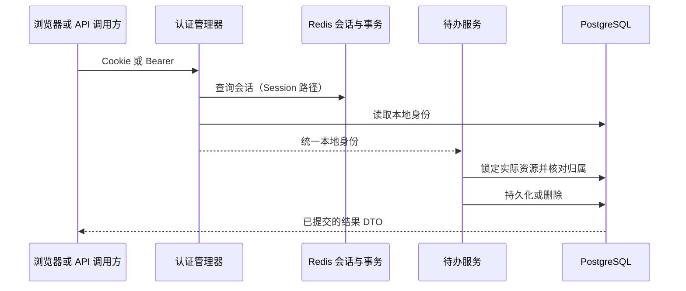

# SRV-001 通用服务端模板设计

本设计落实 2026-11-23 会话已确认方案：三个模板独立组合、个人仓库迁移、统一 UI 包、新项目不承担历史兼容或 shadcn 上游一致性。

## 用户目标

从 Storyworld 提取认证授权、当前用户、PostgreSQL migration、Redis Session、OpenAPI、统一响应、多语言、日志、来源限制，并交付当前用户私有待办 CRUD。

## 业务术语

模板指可以独立安装并用于初始化新项目的仓库；集成环境用于公共能力开发与验证；公开入口是各仓库声明的导出或命令契约。

## 业务角色与权限

维护者修改本人仓库并发布版本；应用开发者选择固定版本并创建自己的项目。实际业务用户只访问自身数据，身份与授权结果以服务端公开契约为准。

## 前置条件

不适用。配置、依赖可用性及外部输入在各自责任边界处理，不用前置条件掩盖当前模块的校验职责。

## 业务输入与输出

GET /api/health 公开返回状态；/api/auth/login、callback/logto、logout 保留原生 OIDC 导航；POST /api/auth/provision 显式 Bearer 建档；GET /api/users/me 返回当前用户。GET /api/todos 按创建时间倒序返回本人待办数组；POST /api/todos 创建；PATCH /api/todos/:id 更新标题或 completed；DELETE /api/todos/:id 删除。标题 trim 后 1..200 字符，PATCH 至少一个字段；completed 为布尔值。列表不增加分页和筛选。响应为 {code,data,message}，HTTP 401/403/404/422/503 保持独立语义。

## 正常业务流程

1. 浏览器登录入口创建独立 state、nonce、PKCE 事务，写 Redis 后跳转 Logto。
2. 回调核验浏览器 state 与一次性事务，换取并验签 ID Token，更新稳定本地用户映射后创建摘要 Session，设置 HttpOnly Cookie 并返回站内地址。
3. 普通接口将 Session 或 Bearer 映射为统一本地身份；有 Authorization 时不改用 Cookie。未建档 Bearer 只允许显式 provision，不隐式创建用户。
4. 当前用户接口返回最小资料；待办列表只查询当前 ownerId。
5. 创建使用认证身份归属；更新与删除锁定实际资源后授权，再持久化并返回结果。

## 业务规则与状态变化

- 登录 state 与 Cookie 不匹配或事务缺失为 400；Token 无效为 401；身份尚未建档为 403；依赖不可用为 503。只有会话创建成功才签发新的 Session Cookie。
- 回调先消费登录事务，再与身份服务交互。身份写入完成后创建 Redis Session；后者失败不签发 Cookie，但已写入的用户资料不回滚到登录前。
- 同一 (issuer,subject) 对应同一本地用户；不按邮箱合并用户。浏览器登录只更新上游实际提供的资料；Bearer 普通读取不更新资料。
- 待办标题 trim 后长度 1..200，创建初始 completed=false；PATCH 至少提供 title/completed 一项。创建与编辑不允许由请求指定 ownerId。
- 列表仅包含本人记录，按 createdAt/id 倒序。不存在为 404，已有但越权为 403；校验和授权失败不改变待办状态。重复标题允许存在。
- 每次实际数据修改由数据库维护 updatedAt；无实质字段变化不伪造更新时间。删除返回成功且 data=null，不增加回收站或恢复能力。

## 业务边界

公开能力只包含本文件规定的模块。未配置真实身份服务时可执行构建及受控认证验证，但不能宣称真实登录已验收。业务数据保存在项目自己的持久化环境中。

## 业务异常情况

| 情况                        | 结果与状态                                    | 恢复                                       |
| --------------------------- | --------------------------------------------- | ------------------------------------------ |
| 未登录或会话过期            | 401，不执行业务 mutation                      | 调用方重新登录                             |
| 未建档 Bearer 身份          | 403，不隐式建档                               | 调用显式 provision                         |
| 越权资源                    | 403，数据不变                                 | 选择本人有权操作的资源                     |
| 资源不存在                  | 404，数据不变                                 | 重新读取列表                               |
| 标题不合法或空 PATCH        | 422，数据不变                                 | 修正输入后重试                             |
| 非可信网页来源              | 403，不执行业务操作                           | 使用登记的入口                             |
| Logto/Redis/PostgreSQL 故障 | 503 或保留统一技术失败，不能伪装未登录或成功  | 故障恢复后由调用方重新操作，不自动重放写入 |
| 回调事务消费后失败          | 保持失败，事务不再复用；没有新 Session Cookie | 发起新的登录尝试                           |

## 架构与技术约束

采用 Bun、Elysia、Zod、PostgreSQL/Drizzle、Redis 与 Logto。文档路由由 `API_PREFIX` 与 `OPENAPI_URL` 拼接，启动日志打印同一路径。接口文档使用 OpenAPI 3.1，与 Zod Standard JSON Schema 的 JSON Schema 2020-12 表达一致，nullable 字符串保持 string|null。只使用 PostgreSQL。认证统一支持 Session/Bearer；Authorization 存在时只验证 Bearer，不降级 Cookie。公开路由显式声明，其他业务默认认证。待办归属 ownerId 来自当前身份；已有资源先读取后授权，越权 403，缺失 404。角色、剧本、AI 模型、S3 及其迁移不进入本模板。

## 环境示例约定

模板记录当前服务器的非密钥连接资料：PostgreSQL 主机 127.0.0.1、端口 15432、用户名 porthole_db_user；Redis 主机 127.0.0.1、端口 6379。数据库名、Redis 逻辑库编号、连接密码和 Logto 密钥由新项目填写，默认不指定共享业务库。DATABASE_URL 与 REDIS_URL 整体留空，连接格式及已知地址写入注释，避免空库名连接串被驱动回退到默认数据库。空配置沿用现有必需变量校验，不增加自动连接、创建数据库或默认身份的行为。

## 模块职责与依赖

当前文档只约束本仓库模块。其他仓库通过其公开契约协作，不访问其内部状态；接口类型以服务端 OpenAPI 为权威，应用状态由使用方所有，通用机制由公共库所有。

## 数据来源与流向

| 数据           | 权威来源                         | 服务端责任模块与方向                       | 生命周期与一致性                             |
| -------------- | -------------------------------- | ------------------------------------------ | -------------------------------------------- |
| 外部身份声明   | 受信任 Logto issuer 的验签结果   | auth manager 验证后映射至本地身份          | 每次认证校验 Token 有效性与 audience/scope   |
| 用户与身份映射 | PostgreSQL users/user_identities | auth manager 写，认证与 /users/me 只读投影 | 唯一身份约束与事务收敛，不按邮箱合并         |
| 登录事务       | Redis 摘要 state key             | auth state store 创建并原子消费            | TTL 到期删除，回调只消费一次                 |
| 浏览器会话     | Redis 摘要 token key             | auth state store 写，认证读取，退出删除    | 浏览器仅持随机 HttpOnly Cookie，过期为未认证 |
| 待办           | PostgreSQL todos                 | domain 经授权读写，service 只读返回 DTO    | 单次写事务，ownerId 不由客户端决定           |
| 接口文档       | 服务路由 Zod schema              | OpenAPI 插件生成，导出命令只读消费         | OpenAPI 3.1，生成方不定义前端状态            |

## 代码行为要求

保留 Storyworld 通用实现后去除领域耦合；users/user_identities/todos 是唯一初始 schema，重新生成初始 migration，SQL 生命周期由 schema 附属源码生成。todos.id 使用随机 UUID，ownerId 外键，createdAt/updatedAt 为毫秒时间；用户更新时间沿用数据库触发器，待办更新时间由数据库触发器维护。创建与更新后的返回值读取持久化结果。数据库异常只由统一边界转换，不吞错或重放写入。认证行为按所提取 manager 保留 state/nonce/PKCE、一次性事务、摘要 Session、TTL 和 OIDC 验签；日志不输出凭据。

## 范围取舍与非目标

不建立历史包名或旧导入兼容层；不要求与 shadcn 上游结构、API 或行为保持一致。保留可访问性、项目内主题和明确的模块契约。业务功能不进入公共库。

## 明确禁止的业务行为

禁止向组织源仓库推送或改写其引用；禁止复制真实凭据和业务数据进入模板；禁止用默认成功结果吞掉失败。违反时本次操作失败且不发布新版本。

## 验收条件

bun run docs:check；bun run check；新隔离 PostgreSQL 与 Redis 上 db:migrate；认证集成测试使用受控 OIDC 服务；真实数据库待办创建、更新、删除与双用户越权用例；OpenAPI 快照与公开来源矩阵验证。

## 联合开发约定

服务可由调用者指定监听主机，联合本地开发只绑定回环。APP_ORIGIN 仍是浏览器来源、Cookie 安全属性和认证回调的依据。

## 认证模式约定

Porthole 接收 Logto 删除、禁用或恢复及组织成员变更通知。删除和禁用拒绝该账号的受保护请求，恢复、组织成员变更和角色分配变更会使此前签发的凭证失效。撤销状态和凭证签发时间在 Porthole 验证，旧会话无需在上线时全量失效。

AUTH_MODE 支持 off、logto 和 local。服务端通过公开 GET /auth/config 报告模式与配置状态。关闭时认证协议路由不可用，现有受保护路由拒绝匿名请求。Logto 模式允许先生成项目再配置身份服务，配置缺失时登录返回 503。自建模式使用管理员创建的账号登录，服务端执行同源检查、密码校验和尝试次数限制。两种登录方式共享当前用户与 Cookie 会话契约，账号和业务资源不自动合并。

## Porthole 服务分享

管理接口沿用认证。能通过 Porthole 的 Logto 应用登录的账号都可使用管理台，各自管理自己的分享。创建和编辑可填写最多 500 字的可选管理描述。永久删除只能由记录所有者发起，并清除该记录的访客会话。只能发布 Linux 所在网络命名空间中已经监听的 TCP 50100–50999。系统从内核监听表取得地址及套接字标识，再识别 HTTP 或 HTTPS。监听消失显示离线，监听标识变化后停止转发，维护者可显式重新连接。

管理主机由 `APP_ORIGIN` 决定。分享使用 `PORTHOLE_SHARE_DOMAIN` 下的单标签子域名。入口 Host 决定分享和服务，用户输入不能决定目标地址。每条分享独立配置发送给上游的 Host，原有记录和新建默认使用公开分享域名。选择本机地址时从已绑定上游的地址和端口生成 Host，转发来源信息仍由公开 URL 生成。一个端口可以产生多个独立分享，各自具有时效、访问额度和密钥。到期及撤销会阻止进入，尚在有效期的访问会话在额度耗尽后继续有效。

额度按首次确认或成功提交密钥后的会话计算。页面浏览和页面资源请求不额外占用额度。PostgreSQL 事务锁定分享后验证状态与额度、登记凭证摘要并更新用量。修改密钥、超期后重新开放、重新连接或撤销会清除旧会话。密码只存散列，密钥明文只在创建或更换时回传。

访问页仅允许向同源提交，以保留原生表单的来源校验。访问页的来源策略仅在同源发送来源信息，成功跳转后不发送访客入口的 Referer。访客会话 Cookie 限于当前分享域名。应用使用 HTTPS 入口时，登录和会话 Cookie 使用浏览器强制的主机前缀，分享上游收到的业务 Cookie 排除访问和管理凭证。分享响应不能设置父域 Cookie。外层代理处理 TLS，并在回环入口保留 Host。
