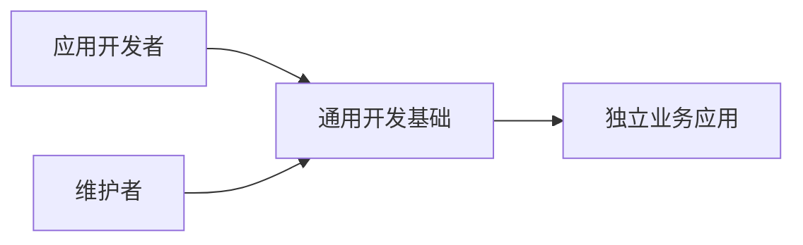

# OD-001 通用服务端模板

## 目标

为新应用提供统一用户身份、资源访问边界、数据持久化与运行治理，并通过私有待办示例演示完整的资源管理流程。

## 产品边界

服务应用开发者和公共能力维护者。个人项目独立演进，组织来源保持原样。源业务的数据与生产配置不作为模板内容。

## 模块与能力

| 能力           | 状态   | 详细设计                                 |
| -------------- | ------ | ---------------------------------------- |
| 通用服务端模板 | 已规划 | [SRV-001](../detailed-design/srv-001.md) |

## 当前范围之外

不交付 Storyworld 的角色、剧本、AI 模型管理或对象存储业务。历史版本兼容与 shadcn 上游一致性不形成产品承诺。

## 废弃说明

不适用，本文件描述新项目的有效目标。

## 联合开发配置

服务可由调用者指定监听主机，联合本地开发只绑定回环。APP_ORIGIN 仍是浏览器来源、Cookie 安全属性和认证回调的依据。

## 可选认证

服务端提供关闭、Logto 托管和自建账号登录三种认证模式。模式切换后重启生效。业务项目决定匿名访问、资源授权与账户关联。
