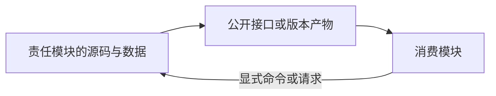

# WEB-001 通用前端模板设计

本设计落实 2026-11-23 会话已确认方案：三个模板独立组合、个人仓库迁移、统一 UI 包、新项目不承担历史兼容或 shadcn 上游一致性。

## 用户目标

基于迁移后的 Starter 与 Storyworld 通用界面，交付欢迎页、应用外壳、主题与双语、后端登录导航、当前用户上下文及私有待办示例。

## 业务术语

模板指可以独立安装并用于初始化新项目的仓库；集成环境用于公共能力开发与验证；公开入口是各仓库声明的导出或命令契约。

## 业务角色与权限

维护者修改本人仓库并发布版本；应用开发者选择固定版本并创建自己的项目。实际业务用户只访问自身数据，身份与授权结果以服务端公开契约为准。

## 前置条件

不适用。配置、依赖可用性及外部输入在各自责任边界处理，不用前置条件掩盖当前模块的校验职责。

## 业务输入与输出

欢迎页支持语言和明暗主题切换，并提供进入应用操作；/app 父布局等待 GET /users/me 成功后渲染 RouterView，UserMenu 与 todos 均处于 provider 子树。待办页展示列表、空态、加载和失败重试，支持创建、编辑标题、勾选完成、删除。保存成功后刷新列表，失败保留草稿并展示本地化错误；提交中避免重复操作。没有角色、剧本或 AI 管理导航。

登录页根据公开的后端配置显示本地登录表单、转到已配置的 Logto，或展示关闭与待配置状态。两种登录模式共享同源会话、当前用户和退出接口。受保护区域只向通过会话校验的用户展示。

## 正常业务流程

开发者安装固定版本，配置示例中声明的外部依赖，运行开发入口并按公开契约扩展应用；维护者完成文档、源码和产物验证后发布新版本。

## 业务规则与状态变化

欢迎页支持语言和明暗主题切换，并提供进入应用操作；/app 父布局等待 GET /users/me 成功后渲染 RouterView，UserMenu 与 todos 均处于 provider 子树。待办页展示列表、空态、加载和失败重试，支持创建、编辑标题、勾选完成、删除。保存成功后刷新列表，失败保留草稿并展示本地化错误；提交中避免重复操作。没有角色、剧本或 AI 管理导航。

## 业务边界

公开能力只包含本文件规定的模块。未配置真实身份服务时可执行构建及受控认证验证，但不能宣称真实登录已验收。业务数据保存在项目自己的持久化环境中。

## 业务异常情况

输入不合法、身份缺失、资源越权或不存在时，调用方保留失败信号，不产生成功状态；具体服务接口遵循本文件契约。CLI 依赖失败返回非零，不继续标记步骤成功；失败不改写来源组织仓库。

## 架构与技术约束

采用 Vue/Vite/TypeScript、统一 @ngt/ui、文件路由、Vue I18n、Alova 与 OpenAPI 生成类型。首页可独立访问，受保护 /app 子树才获取当前用户。前端不持有 Logto secret/token，不安装认证 SDK。组件调用后端统一通过 $api/$req，受保护请求的 401 由 sysApi 确认当前登录方式可用后统一跳转。本地凭据错误留在登录表单，其他错误保留失败。

## 模块职责与依赖

当前文档只约束本仓库模块。其他仓库通过其公开契约协作，不访问其内部状态；接口类型以服务端 OpenAPI 为权威，应用状态由使用方所有，通用机制由公共库所有。

## 数据来源与流向

| 数据       | 权威来源                             | 责任方与消费者               | 方向与一致性                                 |
| ---------- | ------------------------------------ | ---------------------------- | -------------------------------------------- |
| 源码与版本 | 各仓库 Git 提交和稳定标签            | 本仓库维护者；下游只读消费   | 本仓库写、下游固定读取；已发布标签不移动     |
| 公开契约   | 所属模块的源码类型、exports、OpenAPI | 提供方定义，消费方生成或导入 | 不从消费方猜测上游语义                       |
| 用户数据   | 服务端数据库与身份服务               | 服务端写；前端请求只读展示   | 写入必须经授权入口，变更成功后按资源范围刷新 |
| 临时状态   | 当前请求、组件或命令实例             | 各实例唯一 owner             | 卸载或退出后释放，不能当作持久化事实         |

## 代码行为要求

将 Storyworld sysApi、语言加载、偏好、认证导航和 userContext 提取到 Starter；路由与业务页按目标重建。OpenAPI 以本地 src/api/openapi.json 为可离线生成输入，联合模板从后端导出后替换输入，再用既有 openapi-ts 刷新 auto，禁止手写生成类型。依赖解析由仓库的 bun.lock 固定，常规安装使用冻结模式。欢迎页页眉和浏览器标题均读取公开配置 APP_NAME。默认 API /api，开发代理 localhost:3100；Vite 固定 1282 strictPort。统一 NGT 文档投影 docs/ngtui。annotation 开发插件改用个人仓库并去除组织内部服务地址，默认不启用。

## 范围取舍与非目标

不建立历史包名或旧导入兼容层；不要求与 shadcn 上游结构、API 或行为保持一致。保留可访问性、项目内主题和明确的模块契约。业务功能不进入公共库。

## 明确禁止的业务行为

禁止向组织源仓库推送或改写其引用；禁止复制真实凭据和业务数据进入模板；禁止用默认成功结果吞掉失败。违反时本次操作失败且不发布新版本。

## 验收条件

bun run docs:check；bun run generate；bun run check；bun run build；公开首页与受保护页浏览器验证；受控接口下双语/明暗主题、CRUD 成功失败与 401；联合模板真实数据库及受控 OIDC 联调。

## 联合开发约定

浏览器默认通过同源 `/api` 访问后端。开发和构建预览由 Vite 代理，正式运行由 Caddy 提供静态文件与 API 代理。代理保留 API 路径、查询、请求来源、Cookie 和重定向。API 路由与静态页面回退使用独立处理分支，后端异常原样呈现。默认目标为本机 Server，单独部署时由前端运行环境提供内网目标。
