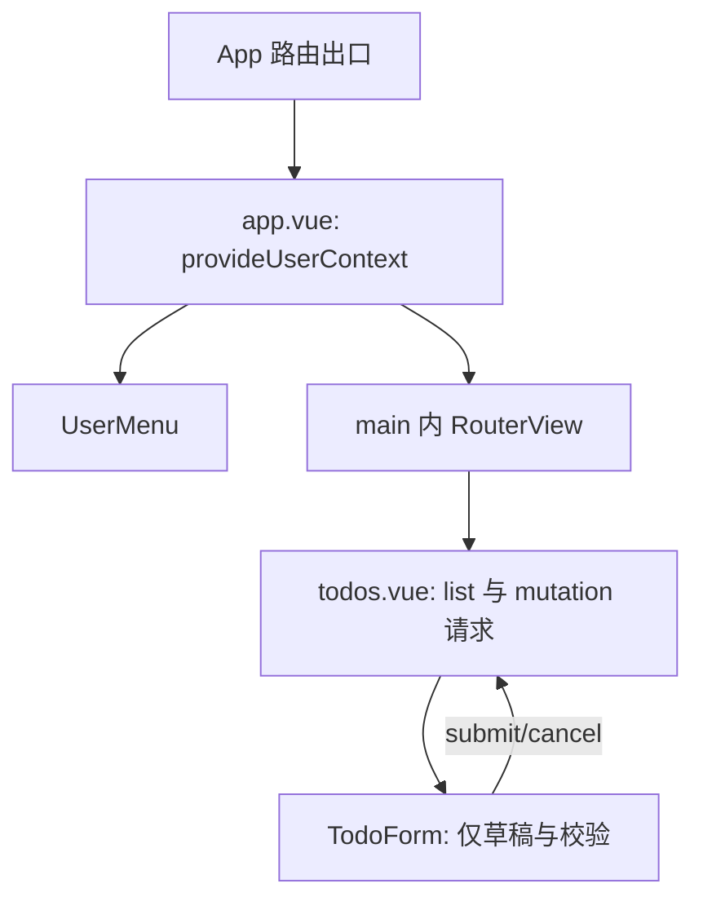

# IMP-WEB-001 通用前端模板实施

## 目标与范围

基于迁移后的 Starter 与 Storyworld 通用界面，交付欢迎页、应用外壳、主题与双语、后端登录导航、当前用户上下文及私有待办示例。

## 详细设计逐项落实

| 设计条目                   | 具体落位                                                                                                                                                                             | 实施章节                 | 验证               |
| -------------------------- | ------------------------------------------------------------------------------------------------------------------------------------------------------------------------------------ | ------------------------ | ------------------ |
| 目标、角色、输入输出和状态 | 本文代码结构所列模块                                                                                                                                                                 | 接口实现契约、控制流程   | 验证方案           |
| 架构、责任与数据流         | 本仓库源码、公开导出及配置                                                                                                                                                           | 数据实现、代码边界       | 类型检查与集成验证 |
| 范围、安全和异常           | 本仓库入口、文档与命令                                                                                                                                                               | 权限与安全、技术异常处理 | 残留审计与失败用例 |
| 验收条件                   | bun run docs:check；bun run generate；bun run check；bun run build；公开首页与受保护页浏览器验证；受控接口下双语/明暗主题、CRUD 成功失败与 401；联合模板真实数据库及受控 OIDC 联调。 | 验证方案                 | 记录实际结果       |

## 技术约束与非目标

采用 Vue/Vite/TypeScript、统一 @ngt/ui、文件路由、Vue I18n、Alova 与 OpenAPI 生成类型。首页可独立访问，受保护 /app 子树才获取当前用户。前端不持有 Logto secret/token，不安装认证 SDK。组件调用后端统一通过 $api/$req，受保护请求的 401 由 sysApi 确认当前登录方式可用后统一跳转。本地凭据错误留在登录表单，其他错误保留失败。

## 代码结构与模块落位

src/views/index.vue、auth/sign-in.vue、app.vue、app/todos.vue；src/features/app/userContext.ts、UserMenu.vue；src/features/todos；src/api/sysApi.ts、useRequest.ts、authNavigation.ts、auto；src/app、src/locales、src/assets；vite.config.ts、openapi-ts.config.ts、env。

## 接口实现契约

欢迎页支持语言和明暗主题切换，并提供进入应用操作；/app 父布局等待 GET /users/me 成功后渲染 RouterView，UserMenu 与 todos 均处于 provider 子树。待办页展示列表、空态、加载和失败重试，支持创建、编辑标题、勾选完成、删除。保存成功后刷新列表，失败保留草稿并展示本地化错误；提交中避免重复操作。没有角色、剧本或 AI 管理导航。

## 数据实现

| 数据           | 唯一运行时 owner 与创建位置                                                   | 分发与允许写入口                                                        | 生命周期与失效                                                 |
| -------------- | ----------------------------------------------------------------------------- | ----------------------------------------------------------------------- | -------------------------------------------------------------- |
| 当前用户       | features/app/userContext.ts 的 shallowRef；父 app.vue 调用 provideUserContext | 只读 computed 提供给 UserMenu 和 RouterView 后代，通过 refresh 重新请求 | 父布局卸载释放；退出通过顶层导航重建应用                       |
| 服务端语言资源 | locales/server.ts 加载器，sysApi 管缓存                                       | protected provider 发起，合并进 Vue I18n；页面只读翻译                  | 语言切换加载对应字典，失败保留所选语言并提供重试               |
| 待办列表       | views/app/todos.vue 唯一 GET $req 的 data/loading/error                       | 模板与列表行只读，refresh 强制重取；cacheFor=0                          | 页面挂载获取、卸载释放，mutation 成功 await refresh            |
| 编辑目标       | todos.vue 的 editing ref，来自当前列表项                                      | 点击编辑设置，传 initialTitle 给 TodoForm                               | 取消关闭；写成功关闭；失败保留同一表单实例                     |
| 编辑草稿       | TodoForm 的 Schema Form 实例                                                  | 控件更新与 submit/cancel emit；页面发起实际请求                         | 创建成功 createKey 重建清空；编辑成功关闭；mutation 失败不重置 |
| mutation 状态  | todos.vue 的 create/update/remove 请求实例                                    | 当前操作调用 run，busy 禁用重复提交                                     | 失败由当前界面展示，不把拒绝改成成功                           |
| 偏好           | app/preferences.ts 的 VueUse storage ref                                      | Preferences/UserMenu 写；App/theme/i18n 只读消费                        | 应用生命周期持久化，页面间不复制                               |

| mutation  | 成功后的失效与更新              | 路由和草稿                           | 失败                                                              |
| --------- | ------------------------------- | ------------------------------------ | ----------------------------------------------------------------- |
| 创建      | await POST 后强制刷新本人列表   | 写成功先清空创建表单；路由不变       | POST 拒绝保留草稿；刷新失败显示列表重试，不把已成功写入当作未保存 |
| 修改/完成 | await PATCH 后强制刷新本人列表  | 写成功关闭编辑器；路由不变           | PATCH 拒绝保留编辑草稿；刷新失败显示列表重试                      |
| 删除      | await DELETE 后强制刷新本人列表 | 关闭对应编辑目标，路由不变           | 删除失败保留旧列表与可重试错误                                    |
| 退出      | 后端协议导航                    | 成功回公开入口，旧 provider 实例释放 | 不伪造退出成功                                                    |

## 组件实现

基础、组合、domain 各模块保留所属上下文和公开入口；页面只消费公开模块，不复制公共实现。ThemeProvider 的直接路由根使用 flex-1/min-w-0 占满可用宽度；欢迎页根负责滚动，受保护布局的 main 单独滚动，header 保持自然高度。前端受保护父布局先 provide 再 await 用户请求；RouterView 只在数据就绪后位于其后代。当前仓库不包含页面时本节不新增页面。

## 控制流程

欢迎页页眉读取 Vite 已规范化的 APP_NAME，与路由标题使用同一入口。bun.lock 与 package.json 一同提交，模板常规安装使用冻结模式。欢迎页不触发服务端语言请求；受保护父布局启动字典加载，用户资料成功后挂载后代。App.vue 使用 onErrorCaptured 展示失败和整页重试，不伪造用户状态。TodoForm.vue 仅拥有 schema form 草稿，通过 submit/cancel emit 交给待办页；页面拥有各 mutation 的 loading/error，成功后清空或关闭编辑并 await 列表 refresh。将 Storyworld sysApi、语言加载、偏好、认证导航和 userContext 提取到 Starter；路由与业务页按目标重建。OpenAPI 以本地 src/api/openapi.json 为可离线生成输入，联合模板从后端导出后替换输入，再用既有 openapi-ts 刷新 auto，禁止手写生成类型。默认 API /api，开发代理 localhost:3100；Vite 固定 1282 strictPort。统一 NGT 文档投影 docs/ngtui。upgrade-ngt-dependencies.ts 仅查个人 UI 的稳定预构建标签，并核验产物记录的源码提交属于 main；--check 只预览，默认更新固定依赖并 bun install。annotation 开发插件改用个人仓库并去除组织内部服务地址，默认不启用。

登录和受保护路由在进入时从 `/auth/config` 读取当前配置。可用的本地模式在 `/auth/sign-in` 调用 `/auth/login/local`；可用的托管模式沿用后端导航登录。关闭或待配置时展示状态与返回首页操作。

## 权限与安全

所有组织 upstream remote 的 push URL 设为 DISABLED，发布只允许 Preyou origin。配置示例只含占位符或明确本地开发值，真实 .env.local 忽略。服务端按资源 ownerId 授权，不信任客户端归属；日志沿用凭据脱敏。

## 状态一致性、事务与并发

数据库为持久化权威，待办写入返回已持久化记录；前端不乐观伪造成功。OIDC 事务原子消费、身份唯一键和 Session TTL 沿用提取的认证实现。模板发布按依赖顺序进行，失败停止，禁止重用稳定标签。

## 代码边界

公开输入在服务端 Zod、CLI 参数与 Git 远端校验边界处理。包内使用相对引用；跨仓库使用公开 exports、OpenAPI 或命令。配置及生成输入先修改再生成；构建目录只由工具产生。

## 技术异常处理

OIDC、Redis、数据库失败由其现有统一边界显式传播；数据库不可用为 503、未认证为 401，不互相混淆。CLI spawn 或构建失败立即非零；不捕获后继续发布。UI 组件只承载错误状态，不解释业务错误码。没有当前模块负责的恢复机制时直接上抛。

## 外部依赖

私有 Git 包安装使用调用方提供的 GITHUB_TOKEN 环境；setup 继承环境，不获取、输出或持久化 Token。

各 manifest 显式声明所消费的第三方包；应用依赖统一 @ngt/ui 的个人稳定产物，Playground 使用本地 file:。服务端运行需要项目隔离的 PostgreSQL、Redis 和配置好的 Logto；受控测试使用测试 OIDC 服务。

## 性能与资源限制

公开组件按子路径导出，库构建 preserveModules；按短子路径消费；Button-only 产物不得引入重量模块。待办标题 1..200 字符，列表仅作最小 CRUD 示例，不引入额外数据检索平台。命令不扫描 node_modules 或业务数据。

## 日志、监控与脱敏

命令记录执行阶段及失败退出，认证/请求日志脱敏；不输出 .env 内容、Token、Session 或组织凭据。验证记录区分受控联调、真实身份服务及浏览器结果。

## 迁移、兼容与回滚

组织仓库只读复制并记录来源提交；个人旧 Yuumi/Server 先保留备份标签。新项目直接使用统一 API，不建立旧包别名。回滚使用保留的个人 Git 提交；不改写源组织引用或已发布标签。

## 验证方案

bun run docs:check；bun run generate；bun run check；bun run build；公开首页与受保护页浏览器验证；受控接口下双语/明暗主题、CRUD 成功失败与 401；联合模板真实数据库及受控 OIDC 联调。

## 实施顺序

1. 先写并确认总体与详细设计，再形成本文。
2. 按本文代码落位实施本仓库。
3. 更新生成输入并运行生成器。
4. 按验证方案完成本仓库检查。
5. 记录结果、提交本仓库，再更新消费仓库固定引用。

## 完成条件

公开契约、源码、文档、生成物和发布产物一致；所有规定检查通过；真实外部环境未验收的部分明确记录，不以构建成功替代运行验收。

## 验证记录

2026-11-23：固定个人 @ngt/ui 2.0.1 预构建标签，sourceCommit 为 55e745b90dca1bf347e61117b0cb5fcbcb997d79。安装、生成、文档/公共投影、类型、Lint 与生产构建通过。受控 API 浏览器覆盖首页零请求、表单标签/唯一输入 ID、待办 CRUD、创建与编辑 500 草稿保留及重试，17 次请求，无页面 JS 异常；本轮不连接真实数据库、Session 或 Logto。

## 公共组件消费

固定 @ngt/ui 2.0.1 预构建标签；TodoForm 使用 @ngt/ui/schema-form，HomeUserMenu 使用 @ngt/ui/icon。仅改变公开导入与依赖固定版本，业务状态、接口、权限、错误和数据刷新保持本设计定义的行为。

## 联合开发实现

Vite 读取 `DEV_WEB_HOST`、`DEV_WEB_PORT` 和 `API_ORIGIN`。联合启动器可用 `DEV_API_ORIGIN` 覆盖本次开发目标。开发和普通构建预览共用代理规则与端口，默认使用 1282。生产 `start` 从前端目录启动 `Caddyfile`，读取 `WEB_SITE` 和 `API_ORIGIN`，服务 `dist` 及同源 `/api`。两套代理默认目标均为 `http://127.0.0.1:3100`。验证实际 API 的相对路径、后端状态、会话 Cookie 和前端路由直接访问。
