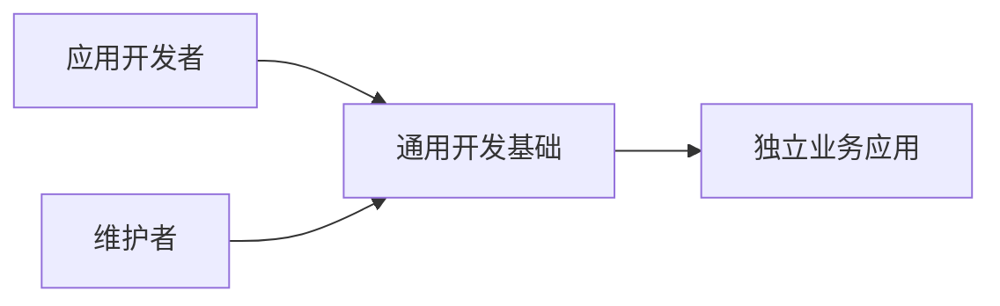

# OD-001 通用前端模板

## 目标

为新 Web 应用提供欢迎入口、个人偏好、登录接入、应用外壳和待办示例，使开发者可以直接开始自己的产品。

## 产品边界

服务应用开发者和公共能力维护者。个人项目独立演进，组织来源保持原样。源业务的数据与生产配置不作为模板内容。

## 模块与能力

| 能力         | 状态   | 详细设计                                 |
| ------------ | ------ | ---------------------------------------- |
| 通用前端模板 | 已规划 | [WEB-001](../detailed-design/web-001.md) |

## 当前范围之外

不交付 Storyworld 的角色、剧本、AI 模型管理或对象存储业务。历史版本兼容与 shadcn 上游一致性不形成产品承诺。

前端模板随仓库交付依赖锁文件和公开默认配置，以便新检出使用相同依赖和应用标识。

## 废弃说明

不适用，本文件描述新项目的有效目标。

## 联合开发配置

前端可独立开发和部署。开发与部署均通过应用入口访问后端 API，前端和后端可部署在不同网络。
